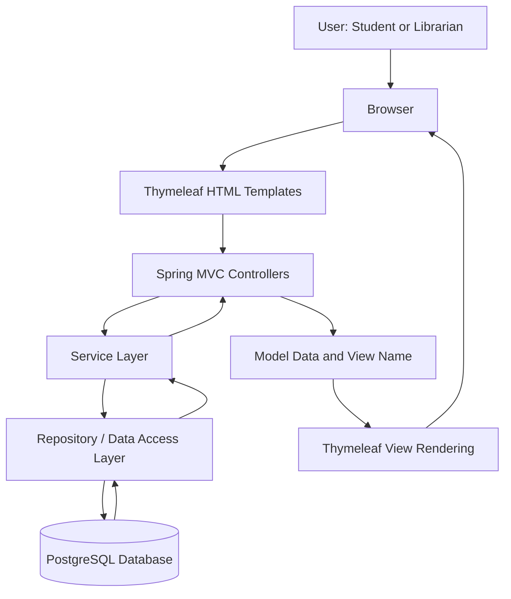
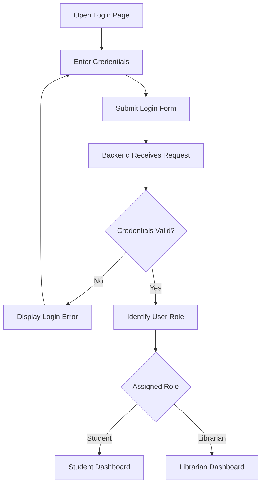
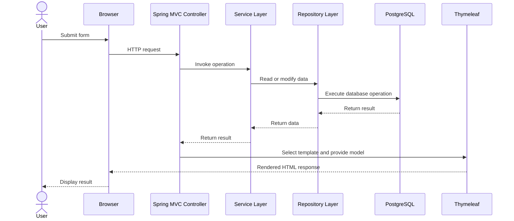

# 📚 Library Management System

A full-stack web application built using **Java, Spring Boot, PostgreSQL, and Thymeleaf** to simplify library operations through a web-based interface. The system provides a common login interface for students and librarians, with role-based redirection to separate dashboards and functionality based on the authenticated user's role.

The project demonstrates Spring Boot MVC architecture, server-side rendering, relational database integration, CRUD operations, authentication, and role-based access control.

## 📌 Table of Contents

- [Project Overview](#-project-overview)
- [Key Features](#-key-features)
- [Technology Stack](#️-technology-stack)
- [System Architecture](#️-system-architecture)
- [Application Workflow](#-application-workflow)
- [Role-Based Login and Authorization](#-role-based-login-and-authorization)
- [Backend Architecture](#-backend-architecture)
- [Database Design](#️-database-design)
- [Project Structure](#-project-structure)
- [Installation and Setup](#️-installation-and-setup)
- [Running the Application](#️-running-the-application)
- [Testing the Application](#-testing-the-application)
- [Security Considerations](#-security-considerations)
- [Future Enhancements](#-future-enhancements)
- [Learning Outcomes](#-learning-outcomes)
- [Author](#-author)

## 🎯 Project Overview

The Library Management System is designed to provide a centralized platform for managing library-related operations through a browser-based application.

Instead of maintaining separate applications for students and librarians, the system uses a common login interface and directs authenticated users to the appropriate dashboard according to their assigned role.

The application uses Spring Boot for backend processing, Thymeleaf for dynamically rendering HTML pages, and PostgreSQL for persistent data storage.

### Project Objectives

- Develop a web application using Java and Spring Boot.
- Implement a structured Model-View-Controller (MVC) architecture.
- Provide a common login flow for different user roles.
- Implement role-based navigation and access to relevant functionality.
- Integrate PostgreSQL for relational data persistence.
- Use Thymeleaf to render dynamic web pages using server-side data.
- Demonstrate maintainable backend development and database integration.

## ✨ Key Features

### 1. Common Login Interface

The application provides a shared login entry point for students and librarians. After authentication, the application identifies the user's role and redirects them to the appropriate dashboard.

### 2. Role-Based Access

Different user roles receive different interfaces and access to functionality relevant to their responsibilities.

- **Student:** Accesses the student dashboard and student-facing library features.
- **Librarian:** Accesses the librarian dashboard and librarian-facing management features.

The precise operations available to each role depend on the implemented controllers and business logic.

### 3. Dynamic Web Pages

Thymeleaf templates render HTML pages using data supplied by Spring MVC controllers. This allows the application to display database records and user-specific information dynamically.

### 4. PostgreSQL Integration

PostgreSQL provides persistent storage for the application's database records. The backend connects to the database to retrieve, create, update, and delete records as required by supported operations.

### 5. CRUD Operations

The application can use Create, Read, Update, and Delete operations to manage supported records. These operations connect the web interface to the backend business logic and database layer.

### 6. Spring Boot MVC Architecture

The application separates request handling, application processing, data access, and presentation into distinct responsibilities. This separation makes the code easier to understand, debug, test, and maintain.

## 🛠️ Technology Stack

| Technology | Purpose |
|---|---|
| Java | Core programming language and application logic |
| Spring Boot | Backend application framework and configuration |
| Spring MVC | HTTP request handling and controller-based web flow |
| Thymeleaf | Server-side HTML template rendering |
| PostgreSQL | Relational database and persistent storage |
| Spring Data JPA / Hibernate | Database access and object-relational mapping, if configured in the project |
| Maven | Dependency management and build automation |
| HTML and CSS | Web page structure and styling |
| JavaScript | Client-side interactions, where implemented |
| Git and GitHub | Version control and source code hosting |

## 🏗️ System Architecture

The application follows a layered web architecture built around the Model-View-Controller pattern.

### High-Level Architecture



The diagram represents the logical architecture of the application. Thymeleaf templates are rendered by the server, while Spring MVC controllers coordinate requests and responses. The exact layer boundaries depend on the implementation.

### Architecture Components

#### 1. Presentation Layer — Thymeleaf

The presentation layer is responsible for displaying the application's user interface.

Thymeleaf templates can contain:

- Login forms and validation messages.
- Student and librarian dashboards.
- Tables displaying records retrieved from the database.
- Forms for submitting or editing information.
- Dynamic page content supplied through the Spring MVC model.

Thymeleaf expressions allow server-provided data to be displayed in HTML templates.

For example, a template can display a value added to the model by a controller:

```html
<p th:text="${message}">Welcome</p>
```

The expression renders the value associated with `message` when the template is processed by Thymeleaf.

#### 2. Controller Layer — Spring MVC

Controllers receive HTTP requests from the browser and decide how to process them.

Typical responsibilities include:

- Handling login and navigation requests.
- Accepting form submissions.
- Calling the relevant service methods.
- Passing data to Thymeleaf templates through the model.
- Returning the appropriate view or redirect.

A controller should primarily coordinate the request rather than contain extensive business logic.

#### 3. Service Layer — Business Logic

The service layer contains application-specific rules and coordinates operations between controllers and data-access components.

Depending on the implemented features, it may handle tasks such as:

- Validating application operations.
- Processing record creation and updates.
- Checking whether a requested operation is permitted.
- Coordinating database operations.
- Applying business rules before saving changes.

Keeping business logic in services helps avoid duplicating the same rules across multiple controllers.

#### 4. Repository Layer — Database Access

The repository layer provides an abstraction for interacting with PostgreSQL.

If Spring Data JPA is used, repository interfaces can provide common database operations without requiring every query to be written manually.

For example, a repository may support operations such as:

- Finding a record by its identifier.
- Retrieving a collection of records.
- Saving a new or updated entity.
- Deleting an existing entity.

The actual repository interfaces and query methods depend on the project's implementation.

#### 5. Model and Entity Layer

Model classes represent the data used by the application. Database entities represent persistent records and their relationships.

Depending on the project, these may include user, student, librarian, or library-related entities. The model and entity layers define the structure of the data processed by controllers, services, and repositories.

#### 6. Database Layer — PostgreSQL

PostgreSQL stores application data persistently, allowing records to remain available across application restarts.

The database can enforce constraints such as primary keys, foreign keys, uniqueness, and required fields when these are defined in the schema.

## 🔄 Application Workflow

### Workflow 1: User Login

The login process provides a common entry point for both students and librarians.



The workflow can be understood in the following steps:

1. The user opens the login page in a browser.
2. The user enters the required credentials and submits the form.
3. Spring MVC receives the request and passes it to the relevant authentication logic.
4. The application validates the credentials using the configured authentication mechanism.
5. If authentication fails, an error message is displayed.
6. If authentication succeeds, the application determines the user's assigned role.
7. The user is directed to the corresponding dashboard.

**Important distinction:** Authentication establishes who the user is. Authorization determines what that authenticated user is permitted to access.

The role may be stored in the database or supplied through the application's configured security mechanism. The exact implementation should be confirmed from the project's authentication and user-model classes.

### Workflow 2: Accessing the Student Dashboard

1. The student logs in using the common login form.
2. The backend authenticates the user.
3. The student's role is identified.
4. The application redirects the student to the student dashboard.
5. Spring MVC loads the appropriate template and any required data.
6. Thymeleaf renders the page, which is returned to the browser.
7. The student can use the features made available to their role.

### Workflow 3: Accessing the Librarian Dashboard

1. The librarian submits credentials through the same login page.
2. The backend authenticates the user.
3. The librarian's role is identified.
4. The application redirects the librarian to the librarian dashboard.
5. The relevant controller retrieves any required information.
6. Thymeleaf renders the librarian dashboard.
7. The librarian can access the management functionality provided by the application.

### Workflow 4: Database Operations

The general request lifecycle for a database-backed operation is:

1. A user performs an action in the browser, such as submitting a form.
2. The browser sends an HTTP request to a Spring MVC controller.
3. The controller validates the incoming request and calls the relevant service, where applicable.
4. The service applies the necessary business rules.
5. The repository or data-access component interacts with PostgreSQL.
6. The database returns the result of the operation.
7. The controller prepares the response and model data.
8. Thymeleaf renders the resulting page, or the application redirects the user to another page.

This flow keeps presentation, business processing, and persistence separate.

## 🔐 Role-Based Login and Authorization

A key design concept in this project is the use of a common login interface for different user roles.

### How the Shared Login Flow Works

The login page does not necessarily need to be duplicated for each role. Instead, the application can authenticate the user through a common process and then determine the destination using the user's role.

For example:

```text
                    Common Login Page
                           |
                           v
                  Credential Validation
                           |
                           v
                    Role Identification
                           |
                 +---------+---------+
                 |                   |
                 v                   v
         Student Dashboard   Librarian Dashboard
```

### Where Is the Role Stored?

The role is typically associated with a user record or provided by the configured security framework. It may be represented by a field, an enum, a relationship, or an authority, depending on the implementation.

A separate `Role` entity is not mandatory. For example, a user entity could store a role value directly, while another design could use a separate role table.

The important point is that the application must consistently identify the authenticated user's role and use it when making access-control decisions.

### Why Authorization Matters

Redirecting a student to a student dashboard is not sufficient by itself to protect librarian functionality.

The backend must also prevent unauthorized users from accessing restricted operations directly through URLs or crafted HTTP requests. If Spring Security is configured, URL and method-level access rules can enforce those restrictions. Otherwise, equivalent authorization checks must be implemented in the application.

This distinction is important when designing applications that support multiple user roles.

## 🧱 Backend Architecture and Request Lifecycle

The following sequence illustrates a typical server-rendered request in a Spring Boot MVC application.



This is a conceptual request sequence. Specific operations may omit the service layer, perform no database access, or use a redirect instead of rendering a view directly.

## 🗄️ Database Design

PostgreSQL is responsible for storing the application's persistent data.

A typical relational design for a library application may include the following conceptual data areas, depending on which features are implemented.

| Data area | Purpose |
|---|---|
| User accounts | Store login-related information |
| Roles or authorities | Represent access permissions, if modeled separately |
| Student records | Store student-specific information |
| Librarian records | Store librarian-specific information, if separate |
| Library records | Store book or other library-related information |
| Transaction records | Track library operations, if implemented |

These are conceptual examples rather than a verified list of tables in this repository.

### Database Integration

The application connects to PostgreSQL using its configured datasource settings. If the project uses Spring Data JPA and Hibernate, Java entities can be mapped to relational tables, allowing the application to work with Java objects while the persistence framework manages SQL operations.

For example, a typical datasource configuration uses:

```properties
spring.datasource.url=jdbc:postgresql://localhost:5432/library_db
spring.datasource.username=${DB_USERNAME}
spring.datasource.password=${DB_PASSWORD}
```

Replace `library_db` with the actual database name used by the project. The username and password should be configured in your local environment.

If Hibernate schema generation is configured, its behavior is controlled by the project's JPA settings. For an existing database, check the configured schema-management strategy before changing it.

## 📁 Project Structure

The following is a **logical reference structure**, not a verified inventory of the repository. Adapt the names to match your actual source folders and Java packages.

```text
Library-Management-System/
│
├── src/
│   └── main/
│       ├── java/
│       │   └── <your-package>/
│       │       ├── controller/       # Handles web requests
│       │       ├── service/          # Business logic, if separated
│       │       ├── repository/       # Data-access interfaces
│       │       ├── model/            # Domain models or entities
│       │       └── config/           # Application configuration, if present
│       │
│       └── resources/
│           ├── templates/            # Thymeleaf HTML templates
│           ├── static/               # CSS, JavaScript and images
│           └── application.properties
│
├── pom.xml                           # Maven dependencies and build
└── README.md                         # Project documentation
```

### Important Files and Directories

- **Controller classes:** Map incoming requests to application operations and views.
- **Service classes:** Apply business rules and coordinate operations, when the project uses a service layer.
- **Repository interfaces:** Handle database access, if the project uses Spring Data repositories.
- **Model/entity classes:** Define application data and database mappings.
- **`templates/`:** Contains Thymeleaf HTML files, such as login and dashboard templates.
- **`static/`:** Contains frontend assets such as stylesheets and JavaScript.
- **`application.properties`:** Defines configuration such as the datasource and application settings.
- **`pom.xml`:** Defines Maven dependencies, build settings, and the Java/Spring Boot project configuration.

## ⚙️ Installation and Setup

### Prerequisites

Install the following software before running the project:

- Java Development Kit (JDK), compatible with the version specified in the project.
- Maven, if the project does not include a Maven wrapper.
- PostgreSQL.
- Git.
- An IDE such as IntelliJ IDEA or Visual Studio Code.

### Step 1: Clone the Repository

Open a terminal and execute:

```bash
git clone https://github.com/tanushreelonare/Library-Management-System.git
cd Library-Management-System
```

### Step 2: Create the PostgreSQL Database

Open PostgreSQL through `psql` or pgAdmin and create the database:

```sql
CREATE DATABASE library_db;
```

If your project expects a different database name, use the configured name instead.

### Step 3: Configure Database Credentials

Open:

`src/main/resources/application.properties`

Configure the datasource using your local PostgreSQL settings. For example:

```properties
spring.datasource.url=jdbc:postgresql://localhost:5432/library_db
spring.datasource.username=${DB_USERNAME}
spring.datasource.password=${DB_PASSWORD}
```

Set `DB_USERNAME` and `DB_PASSWORD` in your local environment before running the application.

If your existing project uses direct property values or a different configuration format, adapt the settings accordingly. Do not commit actual passwords or other secrets to GitHub.

### Step 4: Check Project Dependencies

Open `pom.xml` and verify that the required dependencies are available for your implementation, including Spring Boot, Spring MVC, Thymeleaf, the PostgreSQL driver, and any persistence or security dependencies used by the project.

Do not add Spring Security or Spring Data JPA solely because they appear in this documentation; first confirm whether the project uses them.

### Step 5: Build the Application

If Maven is installed:

```bash
mvn clean install
```

Alternatively, if the repository contains a Maven wrapper, use the appropriate wrapper command for your operating system.

## ▶️ Running the Application

Start the Spring Boot application from your IDE by running the main class annotated with `@SpringBootApplication`.

Alternatively, run:

```bash
mvn spring-boot:run
```

If the Maven wrapper is present, you can use:

```bash
mvnw.cmd spring-boot:run
```

on Windows, or:

```bash
./mvnw spring-boot:run
```

on macOS/Linux.

Once the application starts successfully, open:

**http://localhost:8080**

This is the default URL when the application uses port `8080`. If a different port is configured, use that port instead.

### First-Time Database Setup

Before testing login, ensure that the expected tables and any required initial records exist. Depending on the project's configuration, the schema may be created by Hibernate, database scripts, or another migration mechanism.

If login requires predefined student or librarian accounts, use the project's actual initialization procedure. Do not assume that demo accounts exist unless they have been created.

## 🧪 Testing the Application

The following checks can help verify the main application workflow.

| Test scenario | Expected result |
|---|---|
| Open the application URL | Login page or configured landing page is displayed |
| Submit invalid credentials | Authentication is rejected and an appropriate error is displayed |
| Log in with a valid student account | Student dashboard is displayed |
| Log in with a valid librarian account | Librarian dashboard is displayed |
| Access a supported data-management page | The relevant page loads with appropriate data |
| Submit a valid record form | The record is processed and persisted when the operation succeeds |
| Restart the application | Persisted database records remain available |

These are suggested functional checks, not claims that an automated test suite is included in the repository.

## 🔒 Security Considerations

A multi-role web application should consider the following practices:

- Store passwords using an appropriate password-hashing mechanism rather than plaintext.
- Validate credentials on the server.
- Enforce authorization on protected backend routes and operations.
- Validate and constrain form inputs before processing them.
- Use parameterized queries or an ORM to reduce SQL injection risks.
- Keep database credentials and other secrets outside version control.
- Avoid exposing sensitive user data in logs or error messages.
- Configure session handling and logout behavior appropriately for the authentication mechanism.

The actual security guarantees depend on which authentication and authorization mechanisms are implemented in the project.

## 🚀 Future Enhancements

Potential improvements for a library management application include:

- Book search, filtering, and category-based browsing.
- Book issue and return workflows.
- Borrowing history and due-date tracking.
- Reservation management for unavailable books.
- Automated overdue notifications and fine calculation.
- Pagination and sorting for large datasets.
- More comprehensive validation and error handling.
- Unit and integration tests for controllers, services, and database operations.
- Improved responsive design and accessibility.
- Deployment to a cloud platform with managed PostgreSQL.

These are possible extensions and should not be interpreted as features already implemented.

## 🎓 Learning Outcomes

This project provides practical experience with:

- Java application development and object-oriented programming.
- Spring Boot application configuration and request handling.
- The Model-View-Controller architectural pattern.
- Server-side HTML rendering with Thymeleaf.
- Relational database integration using PostgreSQL.
- CRUD operations and persistent data management.
- Authentication, role identification, and authorization concepts.
- Maven-based dependency management and project builds.
- Git and GitHub for version control and portfolio presentation.

## 👩‍💻 Author

**Tanushree Lonare**

GitHub: [@tanushreelonare](https://github.com/tanushreelonare)

Repository: [Library Management System](https://github.com/tanushreelonare/Library-Management-System)

---

If you find this project useful, consider giving the repository a ⭐ on GitHub.

*This project is intended for educational purposes and demonstrates the development of a role-based, database-driven web application using Java and Spring Boot.*
